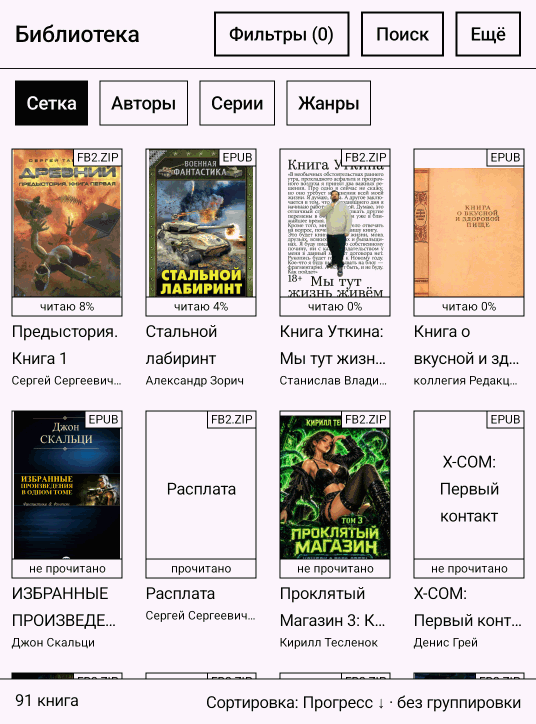
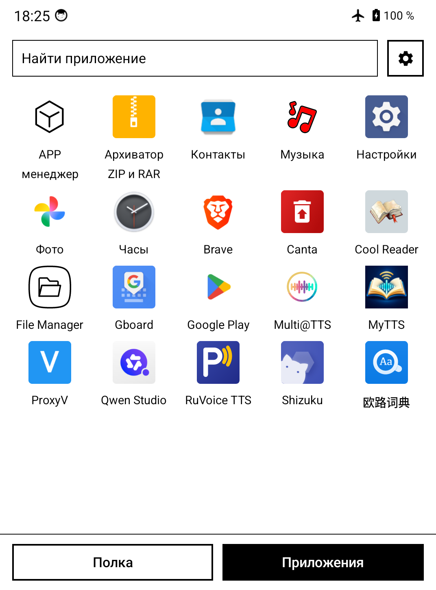
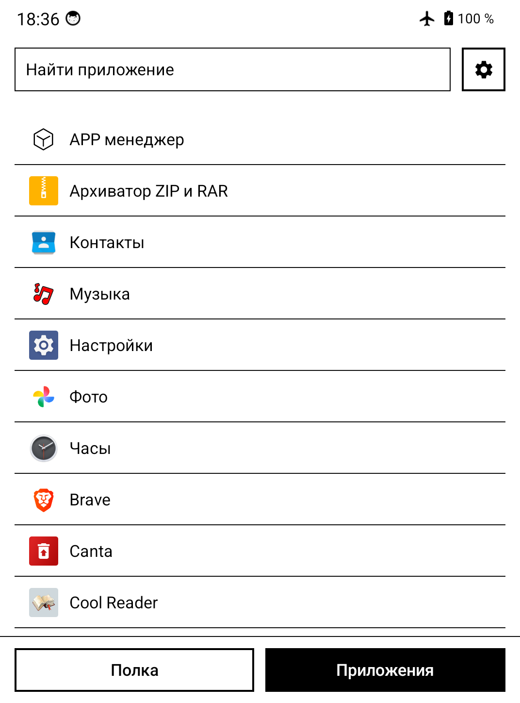
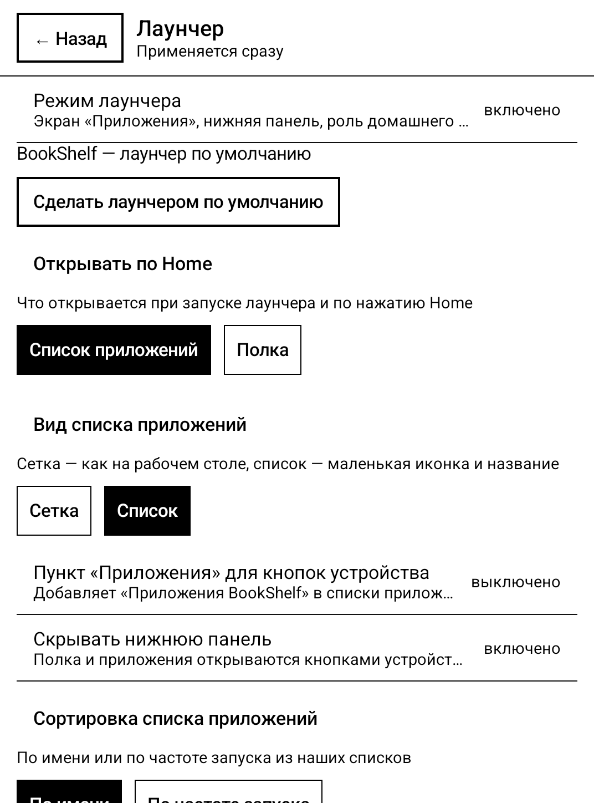
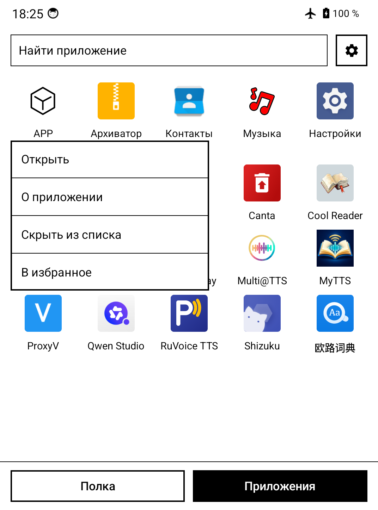
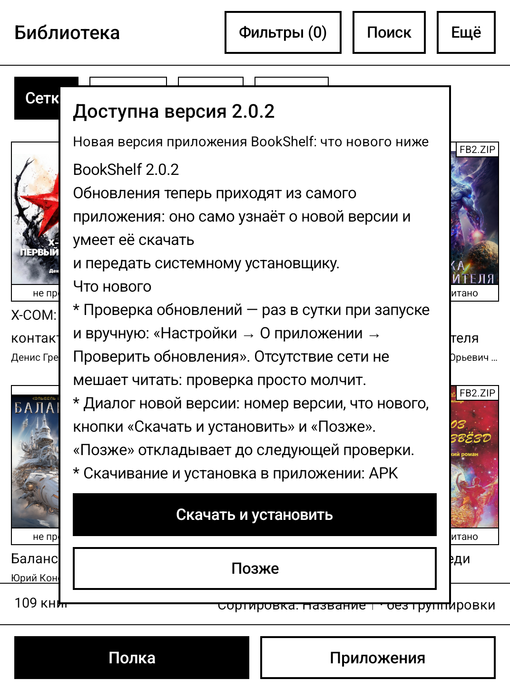
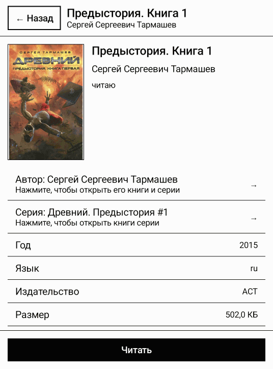
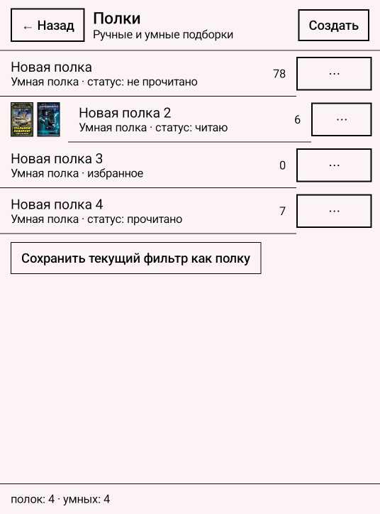
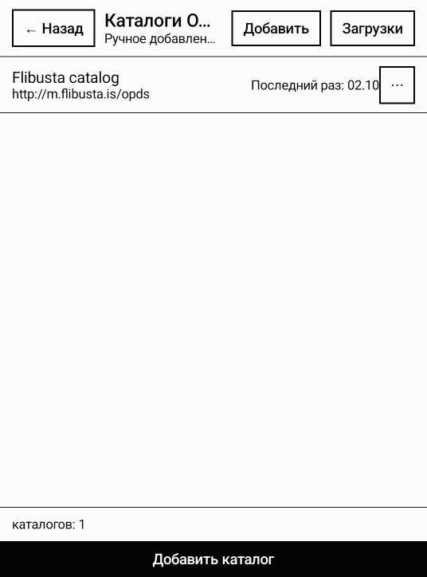
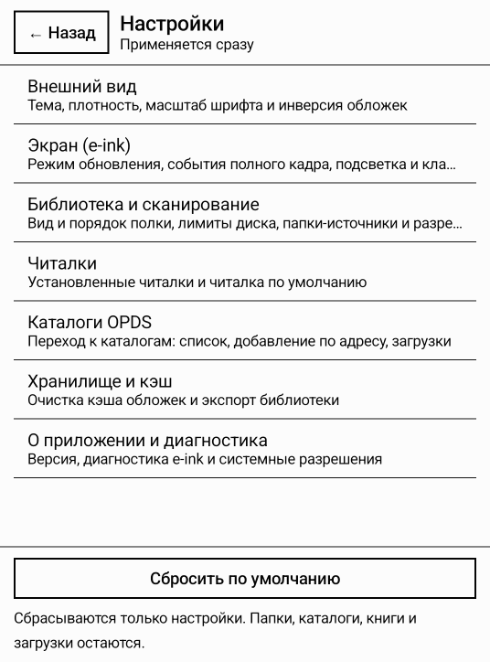

# BookShelf

**A home library for e-ink screens.** BookShelf finds books in the folders you point it at, works
out titles, authors, series and covers itself, and shows everything on a bookshelf. It does not
read the book — your reader app does: BookShelf hands the book over in one tap and pulls the
reading progress back onto the shelf.

> Русская версия: [README.md](README.md)



## Features

### Library

* **Books stay where they are.** The app never copies or "imports" files: you pick folders
  (internal storage, SD card, USB drive) and the shelf shows their contents. Your order on disk is
  your order in the library.
* **Metadata and covers are parsed automatically:** FB2 and FB2.ZIP, EPUB 2/3, PDF, TXT, CBZ and
  CBR (comics), DOCX, ODT, RTF, MOBI/AZW3/PRC. Encodings (cp1251 included), archives, series and
  series numbers are read from the file itself — nothing to fill in.
* **A USB drive is a shelf.** Insert the media and a row with its books appears; pull it out and the
  books leave with it, nothing dangles in the library.
* **Duplicates** are found by file content, not by name: identical books are shown as a list.
* **Lossless FB2 compression.** Markup and images are compressed while text, tags and the images
  themselves stay the same — the result is verified by parsing it again instead of being trusted.
  The gain depends on the book: on dense illustrated books it is measured in percent.

### Order and search

* Filters by author, series, genre, format and reading status; library overview by authors,
  series and genres.
* Search by title, author, series, file name and annotation, with suggestions while you type.
* Sorting (title, author, series, date added, date opened, size, progress) and shelf grouping.
* Shelves: manual collections and smart ones — "everything matching a rule", for example
  "unread, genre: science fiction".

### Reading

* A book opens in your reader app, and a reader can be chosen as the default per format.
* Only apps that really read books are listed: dictionaries and browsers that can open a file are
  filtered out.
* Reading progress from FBReader comes back to the shelf — you see "reading 8%", not "unread".

### Launcher mode

Optionally BookShelf becomes the device home screen: books and other apps in one place, without a
heavy vendor shell.

| Apps (grid) | Apps (list) |
|---|---|
|  |  |

* **Bottom bar "Shelf | Apps"** is the entry to the list of installed apps. The active tab is
  inverted, tab state is preserved. The bar can be **hidden** (see the settings below) when the
  device has vendor buttons.
* **The list works like a regular launcher:** grid or list "icon and name", search by name, sorting
  by name or by launch frequency, favourites. System apps are hidden by default; the checkbox shows
  only the useful ones (settings, files, camera, clock, contacts, store, keyboard, music) — vendor
  service entries are never shown.
* **Long press** opens a menu next to the icon: open, app info, uninstall, hide from list, add to
  favourites. Hidden apps are restored in **Settings → Launcher → Hidden apps**.
* **Home screen with one button.** "Settings → Launcher → Set as default launcher" opens the system
  home-app picker — no need to dig through the system settings.
* **What opens on Home** is your choice: the apps list (default) or the shelf.
* **Launching the app** (icon or hardware button) opens the shelf, like a normal app; Home opens the
  selected screen.
* **Hardware buttons.** "Settings → Launcher → 'Apps' item for device buttons" adds a separate entry
  to the device app list so it can be assigned to a button. If the system shows one entry per
  package (Bigme does), the separate entry will not appear — the button opens the shelf and the apps
  list stays a tab.
* **Mode settings:** turn the whole mode on or off, hide the bottom bar, list style, sorting, reset
  launch statistics, "collapse instead of exiting" (BACK at the root collapses the home screen
  instead of closing it).

| Launcher settings | Long-press menu |
|---|---|
|  |  |

To turn the mode off completely: **Settings → Launcher → Launcher mode** — the app stays a plain
shelf, the bottom bar and the home-screen role disappear, and the role is released.

### Updates

* The app finds out about a new version by itself: once a day on launch and via the "Check for
  updates" button in "About".
* A new version is shown as a dialog with the change list: "Download and install" downloads the APK
  and hands it to the system installer (Android asks for confirmation — this cannot be bypassed),
  "Later" postpones it until the next check.
* On the first run the system asks to allow "install unknown apps" for BookShelf — the app opens the
  right settings screen.
* Checks can be turned off: "Settings → About → Check for updates"; a disabled setting makes no
  network request at all.
* The Google Play build has no checks: updates there come from the store.



### OPDS catalogs

* Connect OPDS catalogs, browse sections, search and download books straight into your folder.
* Downloads are queued, each one shows its state, and a failure is explained in words.
* A path template arranges downloads into folders (by series, for example) the way you like.

### Book card



Cover, every piece of information found, annotation, file path and actions: read, add to
favourites, mark as read, put on a shelf, show in folder, edit metadata, optimise the file or delete
the book together with the file — deletion asks for confirmation and really removes the file.

### Built for e-ink

* No animations, shadows or translucent layers — only an instant frame change.
* Page and hardware-key paging, large elements, contrast typography.
* Frontlight and screen refresh modes go through vendor controllers where they exist. If the device
  cannot be controlled, the app says so honestly instead of pretending.
* Background work yields to an open reader app: parsing and syncing never get in the way of reading.

## Screenshots

| Shelves | OPDS catalogs | Settings |
|---|---|---|
|  |  |  |

## Installation

### Prebuilt APKs

APKs are published in [Releases](https://github.com/mops1k/book-shelf/releases):

| Build | What is inside |
|---|---|
| `BookShelf-<version>-full.apk` | Everything, including CBR comics |
| `BookShelf-<version>-fdroid.apk` | No CBR: the RAR unpacker is distributed under the UnRar licence, which F-Droid does not accept |

### From source

JDK 17+ and the Android SDK (compileSdk 37) are required. The SDK path goes to `local.properties`
or `ANDROID_HOME`.

```bash
# build
./gradlew :app:assembleFullDebug        # full build: all files and CBR comics
./gradlew :app:assembleFdroidDebug      # no CBR (non-free RAR unpacker)
./gradlew :app:assemblePlayDebug        # SAF only, no "access to all files"

# install on a connected device
./gradlew :app:installFullDebug

# checks
./gradlew testDebugUnitTest             # unit tests of all modules
./gradlew detekt                        # static analysis
./gradlew :app:connectedFullDebugAndroidTest   # instrumented tests (emulator or device)
./gradlew koverXmlReportDebug :app:koverXmlReportFullDebug   # coverage reports (Kover)
node tools/check-coverage.mjs           # per-module coverage threshold (config/coverage.json)
node tools/check-sources.mjs            # source sanity
node tools/check-versions.mjs           # every version in the catalog exists
node tools/check-reachability.mjs       # every route is reachable
node --test tools/*.test.mjs            # tests of the repository tools themselves

# release builds: signing key in `keystore.properties` at the root,
# in CI the same values come from environment variables
./gradlew :app:assembleFullRelease :app:assembleFdroidRelease
```

The whole gate in one line:

```bash
./gradlew testDebugUnitTest :app:testFullDebugUnitTest :app:testFdroidDebugUnitTest \
  :app:testPlayDebugUnitTest :app:assembleFullDebug :app:assembleFdroidDebug \
  :app:assemblePlayDebug :app:assembleFullDebugAndroidTest detekt \
  koverXmlReportDebug :app:koverXmlReportFullDebug --continue
node tools/check-coverage.mjs && node --test tools/*.test.mjs
```

## Requirements

* Android 7.0 (API 24) or newer.
* A reader app for books — BookShelf is a shelf, not a reader. Tested with FBReader.
* An e-ink screen is not required: everything works on a regular screen, it just looks larger and
  more contrasty than usual.

## Privacy

* No account, no subscription, no analytics, no crash reports.
* The network is used for OPDS catalogs and their covers — and only while you have a catalog open.
* One service request — the update check: once a day the app asks GitHub (`api.github.com`, the
  latest BookShelf release) for the version number. It sends nothing about you beyond ordinary
  network data and is fully disabled by the "Check for updates" setting.
* The update itself is downloaded from GitHub Releases and only after "Download and install" is
  pressed.
* The library, settings and cover cache stay on the device.

## License

[MIT](LICENSE). The `full` flavour uses the RAR unpacker `junrar` under the UnRar licence — that is
why two builds exist: `full` with comics and `fdroid` without them.
