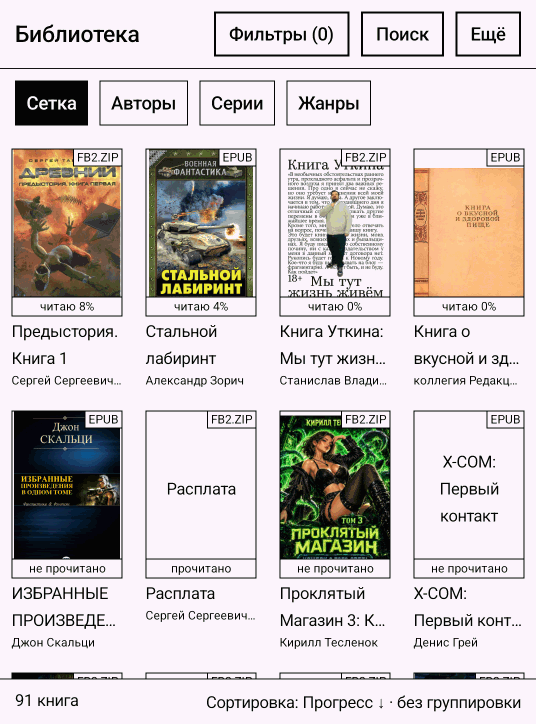
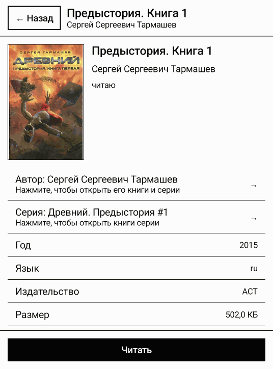
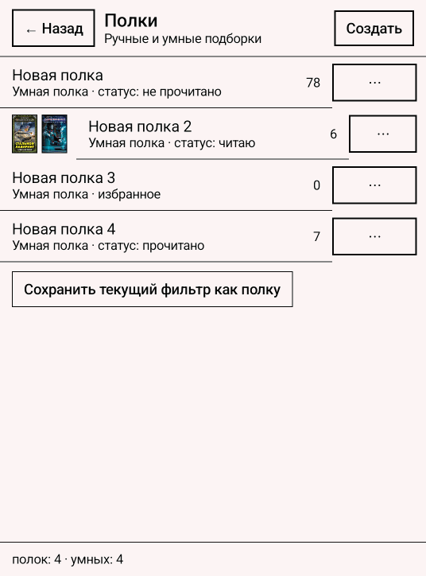
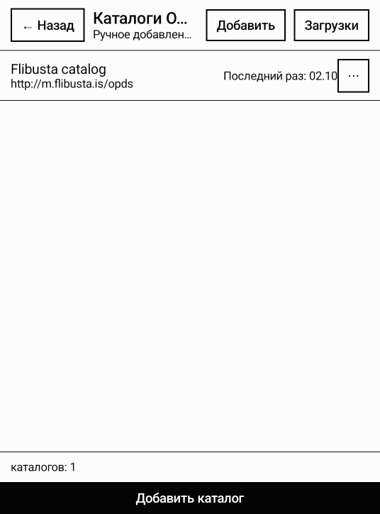
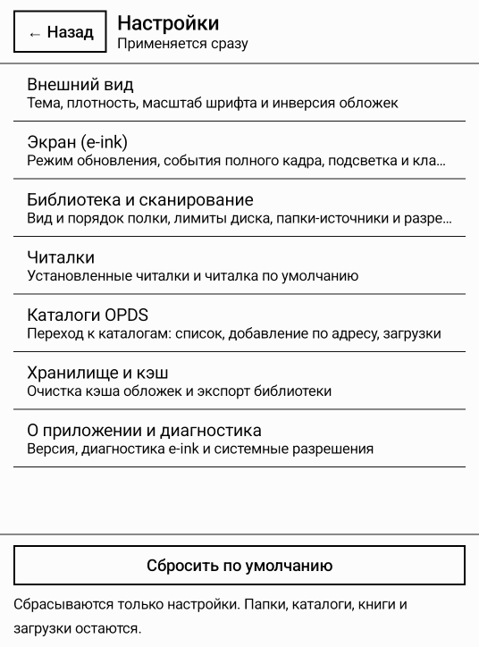

# BookShelf

**Домашняя библиотека для экранов на электронных чернилах.** BookShelf находит книги в папках,
которые вы ему указали, сам разбирает названия, авторов, серии и обложки и показывает всё книжной
полкой. Читает книгу не он, а ваша читалка: BookShelf доводит книгу до неё одним нажатием и
подтягивает прогресс чтения обратно на полку.



## Возможности

### Библиотека

* **Книги остаются там, где лежат.** Приложение не копирует и не «импортирует» файлы: вы
  указываете папки (внутренняя память, карта памяти, флешка), а полка показывает их содержимое.
  Ваш порядок на диске — ваш порядок в библиотеке.
* **Метаданные и обложки разбираются сами:** FB2 и FB2.ZIP, EPUB 2/3, PDF, TXT, CBZ и CBR
  (комиксы), DOCX, ODT, RTF, MOBI/AZW3/PRC. Кодировки (включая cp1251), архивы, серии и номера
  в серии читаются из файла — спрашивать ничего не нужно.
* **Флешка как полка.** Вставили носитель — на полке появилась строка с его книгами; вынули —
  книги ушли вместе с ним, ничего не «повисло» в библиотеке.
* **Дубликаты** находятся по содержимому файла, а не по имени: одинаковые книги видно списком.
* **Сжатие FB2 без потери данных.** Разметка и картинки сжимаются, а текст, теги и сами
  изображения остаются теми же — результат проверяется повторным разбором, а не берётся на веру.
  Выигрыш зависит от книги: на плотных книгах с картинками он измеряется процентами.

### Порядок и поиск

* Фильтры по автору, серии, жанру, формату и статусу чтения; обзор библиотеки по авторам, сериям
  и жанрам.
* Поиск по названию, автору, серии, имени файла и аннотации, с подсказками по мере ввода.
* Сортировка (название, автор, серия, дата добавления, дата открытия, размер, прогресс) и
  группировка полки.
* Полки: ручные подборки и умные — «всё, что подходит под правило», например «не прочитано,
  жанр: фантастика».

### Чтение

* Книга открывается в вашей читалке, а читалку можно назначить по умолчанию отдельно для каждого
  формата.
* В списке читалок показываются только те приложения, которые действительно читают книги:
  словари и браузеры, умеющие открыть файл, туда не попадают.
* Прогресс чтения из FBReader возвращается на полку — видно «читаю 8 %», а не «не прочитано».

### Каталоги OPDS

* Подключайте OPDS-каталоги, ходите по разделам, ищите и скачивайте книги сразу в свою папку.
* Загрузки идут очередью, у каждой видно состояние, а при отказе — причину словами.
* Шаблон пути раскладывает скачанное по папкам (например, по сериям) так, как вам удобно.

### Карточка книги



Обложка, все найденные сведения, аннотация, путь к файлу и действия: читать, в избранное,
отметить прочитанной, положить на полку, показать в папке, изменить метаданные, оптимизировать
файл или удалить книгу вместе с файлом — удаление спрашивает подтверждение и стирает файл
по-настоящему.

### Сделано для электронных чернил

* Никаких анимаций, теней и полупрозрачных слоёв — только мгновенная смена кадра.
* Листание страницами и аппаратными клавишами, крупные элементы, контрастная типографика.
* Подсветка и режимы обновления экрана — через вендорские контроллеры, где они есть. Если
  устройство управлять собой не даёт, приложение честно об этом говорит, а не делает вид.
* Фоновые работы уступают дорогу открытой читалке: разбор и синхронизация не мешают читать.

## Как это выглядит

| Полки | Каталоги OPDS | Настройки |
|---|---|---|
|  |  |  |

## Установка

### Готовые сборки

APK публикуются в разделе [Releases](https://github.com/mops1k/book-shelf/releases):

| Сборка | Что внутри |
|---|---|
| `BookShelf-<версия>-full.apk` | Всё, включая комиксы CBR |
| `BookShelf-<версия>-fdroid.apk` | Без CBR: распаковщик RAR распространяется под лицензией UnRar, которая не подходит для F-Droid |

### Из исходников

Нужны JDK 17+ и Android SDK (compileSdk 37). Путь к SDK — в `local.properties` или в `ANDROID_HOME`.

```bash
# сборка
./gradlew :app:assembleFullDebug        # полная сборка: все файлы и комиксы CBR
./gradlew :app:assembleFdroidDebug      # без CBR (несвободный распаковщик RAR)
./gradlew :app:assemblePlayDebug        # только SAF, без «доступа ко всем файлам»

# установка на подключённое устройство
./gradlew :app:installFullDebug

# проверки
./gradlew testDebugUnitTest             # юнит-тесты всех модулей
./gradlew detekt                        # статический анализ
./gradlew :app:connectedFullDebugAndroidTest   # инструментальные тесты (эмулятор или устройство)
./gradlew koverXmlReportDebug :app:koverXmlReportFullDebug   # отчёты покрытия (Kover)
node tools/check-coverage.mjs           # порог покрытия по модулям (config/coverage.json)
node tools/check-sources.mjs            # санитария исходников
node tools/check-versions.mjs           # каждая версия из каталога существует
node tools/check-reachability.mjs       # все маршруты достижимы
node --test tools/*.test.mjs            # тесты самих инструментов репозитория

# релизные сборки: подпись — ключ `keystore.properties` в корне,
# в CI те же значения приходят переменными окружения
./gradlew :app:assembleFullRelease :app:assembleFdroidRelease
```

Полный гейт одной строкой:

```bash
./gradlew testDebugUnitTest :app:testFullDebugUnitTest :app:testFdroidDebugUnitTest \
  :app:testPlayDebugUnitTest :app:assembleFullDebug :app:assembleFdroidDebug \
  :app:assemblePlayDebug :app:assembleFullDebugAndroidTest detekt \
  koverXmlReportDebug :app:koverXmlReportFullDebug --continue
node tools/check-coverage.mjs && node --test tools/*.test.mjs
```

## Требования

* Android 7.0 (API 24) или новее.
* Читалка для книг — BookShelf это полка, а не читалка. Проверено с FBReader.
* Экран на электронных чернилах не обязателен: на обычном экране всё работает, просто выглядит
  крупнее и контрастнее обычного.

## Приватность

* Ни аккаунта, ни подписки, ни аналитики, ни отправки отчётов о падениях.
* Сеть нужна только для OPDS-каталогов и загрузки обложек оттуда — и только когда каталог открыт
  вами.
* Библиотека, настройки и кэш обложек остаются на устройстве.

## Лицензия

[MIT](LICENSE). Во flavor `full` используется распаковщик RAR `junrar` под лицензией UnRar —
поэтому и существуют две сборки: `full` с комиксами и `fdroid` без них.
